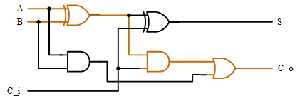
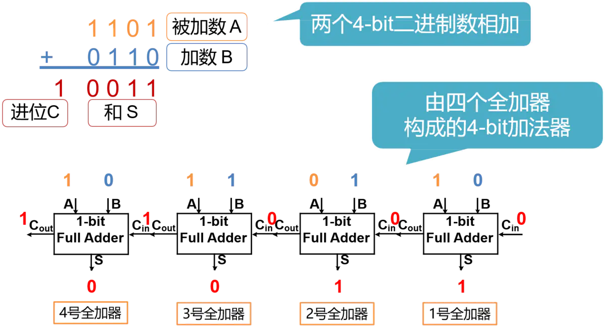
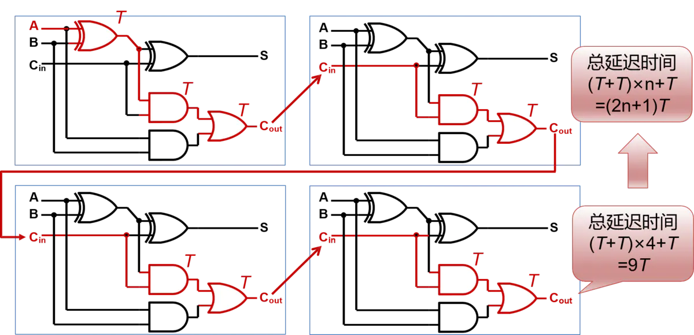
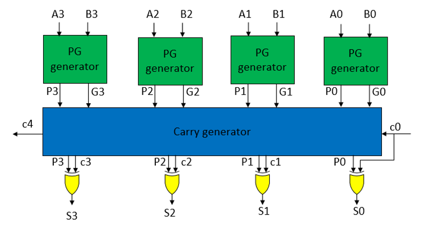
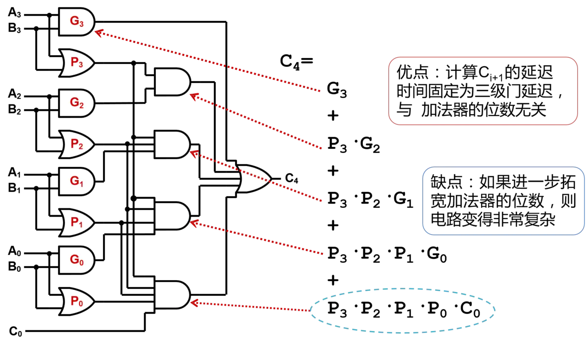
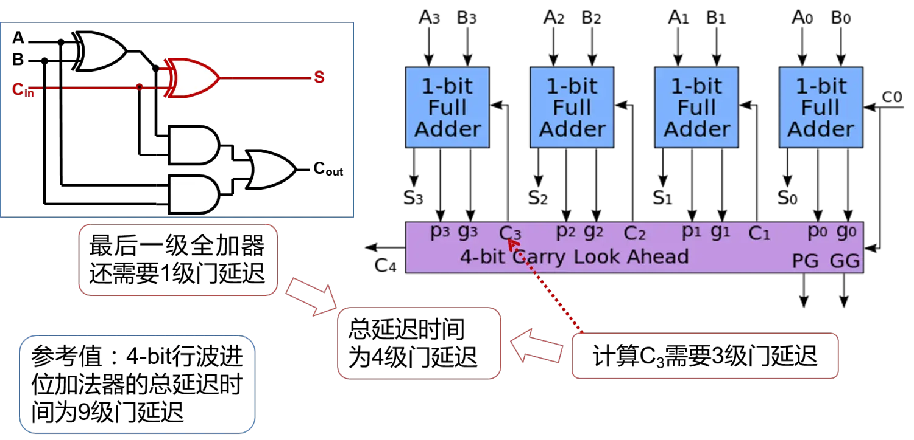

# 加法器

#### 半加器

半加器是最简单的加法器。它不考虑进位输入。其中`A`​和`B`​是两个加数，`S`​是和，`C_o`是进位输出。

```verilog
assign S     = A ^ B;
assign C_out = A & B;
```

#### 全加器

全加器是多bit加法器的基础。𝐶𝑖是进位输入。

$$
𝑆=𝐴⊕𝐵⊕𝐶_𝑖 \\
𝐶_𝑜=𝐴𝐵+𝐶_𝑖(𝐴⊕𝐵)
$$

下图中红色路径是全加器的关键路径。



```verilog
module full_adder(
    input  A,
    input  B,
    input  C_i,
    output S,
    output C_o
);
    assign S    = A ^ B ^ C_i;
    assign C_o  = A & B | C_i & (A ^ B);
    // assign C_o  = A & B | A & C_i | B & C_i; // 也可以
endmodule
```

#### 行波进位加法器

Ripple-carry adder, RCA。将全加器串联起来。 虽然RCA结构简单易于理解，但容易看出，每一位的运算结果𝑆𝑘Sk都要依赖进位𝐶𝑘Ck才能得出。如下图所示，这会使得RCA的关键路径变得很长，而长关键路径会让电路难以满足时序要求。



‍



```verilog
module rca #(
    parameter width = 4
)(
    input  [width-1:0] A,
    input  [width-1:0] B,
    output [width-1:0] S,
  
    input  C_i,
    output C_o
);
    wire [width:0] C;
    genvar i;
    generate
      	for (i=0; i<width; i=i+1)begin
            full_adder myadder(
                .A    (A[i]),
                .B    (B[i]),
                .C_i  (C[i]),
                .S    (S[i]),
                .C_o  (C[i+1]),
            );
        end
    endgenerate
  	assign C[0] = C_i;
    assign C_o  = C[width];
endmodule

```

#### 超前进位加法器

Lookahead Carry Adder，LCA。超前进位加法器的思想是并行计算进位$C_k$，以缩短关键路径。$C_k$可以直接由加数得到。



其求解公式如下所示。

这里的P和G就是传播信号和生成信号，其实是个半加器。

$$
\begin{cases}P_k=A_k\oplus B_k,&\text{k=0,...,N-1}\\G_k=A_kB_k&\text{k=0,...,N-1}\end{cases}
$$

进位输出计算公式如下。

$$
\begin{cases}
S_k=P_k\oplus C_{k},&\text{k=1,...,N}\\
C_k=G_{k-1}+C_{k-1}P_{k-1}&\text{k=1,...,N}\\
C_N=C_{out}\\
C_0=C_{in}
\end{cases}
$$

超前进位加法器是通过公式直接导出最终结果与每个输入的关系，是一种用面积换性能的方法。加法器宽度越大，性能优势越明显。但LCA的逻辑门扇入扇出比较大，面积和复杂度都比较高。

以4bitLCA为例，我们

$$
\begin{cases}
C_1=G_0+C_0P_0\\
C_2=G_1+C_1P_1=G_1+G_0P_1+C_0P_1P_0\\
C_3=G_2+C_2P_2=G_2+G_1P_2+G_0P_2P_1+C_0P_2P_1P_0\\
C_4=G_3+C_3P_3=G_3+G_2P_3+G_1P_3P_2+G_0P_3P_2P_1+C_0P_3P_2P_1P_0\end{cases}
$$

计算路径如下，只需要三级门电路就可以得到输出。





```verilog
module lca_4 #( width=4 ) (
    input  [width-1:0] op1,
    input  [width-1:0] op2,
    input  C_i,
    output [width-1:0] S,
    output C_o
);
    wire [width-1:0] G;
    wire [width-1:0] P;
    wire [width:0] C;

	genvar i;
	for( i=0; i<width; i=i+1) begin
    	pg_gen u_pg_gen(
        	.A( op1[i]),
        	.B( op2[i]),
            .G( G[i]  ),
            .P( P[i]  )
    	);
	end

    assign C[0] = C_i;
    assign C[1] = G[0] || ( C[0] & P[0] );
    assign C[2] = G[1] || ( (G[0] || ( C[0] & P[0]) ) & P[1] );
    assign C[3] = G[2] || ( (G[1] || ( (G[0] || (C[0] & P[0]) ) & P[1])) & P[2] );
    assign C[4] = G[3] || ( (G[2] || ( (G[1] || ( (G[0] || (C[0] & P[0]) ) & P[1])) & P[2] )) & P[3]);
    assign C_o = C[width-1];

	genvar k;
	for( k=0; k<width; k=k+1) begin
        assign S[k] = P[k] ^ C[k];
	end
endmodule

//半加器子模块
module pg_gen(
    input A,
    input B,
    output G,
    output P
);
	assign G = A & B;
	assign P = A ^ B;
endmodule
```

‍

```verilog
`timescale 1ns/1ns

module lca_4(
	input		[3:0]       A_in  ,
	input	    [3:0]		B_in  ,
    input                   C_1   ,
 
 	output	 wire			CO    ,
	output   wire [3:0]	    S
);

	wire [3:0] g = A_in & B_in;
	wire [3:0] p = A_in ^ B_in;
	wire [3:0] c;

	genvar n;
	generate 
		for(n=0; n<3; n=n+1) begin
			assign c[n+1] = g[n] + p[n]*c[n];
		end
		for(n=0; n<4; n=n+1) begin
			assign S[n] = p[n] ^ c[n];
		end
	endgenerate

	assign c[0] = C_1;
	assign CO = c[3];
  
endmodule
```

列表比较一下RCA和CLA的优缺点：

||RCA|CLA|
| ----------| ----------------------------------------------| ----------------------------------------------------------------------|
|结构特点|低位全加器的Cout连接到高一位全加器Cin|每个全加器的进位输入并不来自于前一级的全加器，而是来自超前进位的逻辑|
|优点|电路布局简单，设计方便|计算Ci+1的延迟时间固定为三级门延迟，与加法器的位数无关|
|缺点|高位的运算必须等待低位的运算完成，延迟时间长|如果进一步拓宽加法器的位数，则电路变得非常复杂|

　　32位的加法器如果采用行波进位的方式，需要65级的门延迟， 那如果采用超前进位的方式，理想情况下也只需要四级的门延迟，但可惜的是， 这也只是一个理想。因为要实现32位的完全的超前进位，电路就会变得非常的复杂。 因此通常的实现方法， 是采用多个小规模的超前进位加法器拼接而成一个较大的加法器，例如，用4个8-bit的超前进位加法器连接成32-bit加法器。
