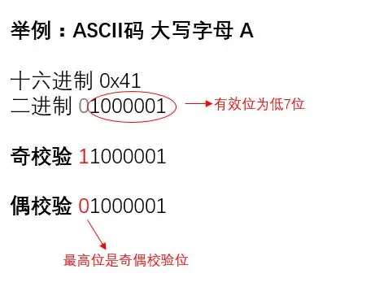

# 奇偶校验

所谓奇偶校验，是指在百代码传送过程中用来检验是否出现错误的一种方法，一般分奇校验和偶校度验两种。

- 奇校验规定：正确的代码一个字专节中1的个数必须是奇数，若非奇数，则校验位添1。

- 偶校验规定：正确属的代码一个字节中1的个数必须是偶数，若非偶数，则校验位添1。

例子：在标准ASCII中，其最高位(b7)用作奇偶校验位。

- 奇数：odd，奇校验：odd parity
- 偶数：even，偶校验：even parity



计算奇偶校验的方法：使用^a即可

结果为0，则偶数个1，奇校验位为1，偶校验位为0

结果为1，则奇数个1，奇校验位为0，偶校验位为1

```verilog
module odd_sel(
  input [31:0] bus,
  input sel,
  output check
);
  wire even = ^bus;
  assign check = sel ? even:~even;
endmodule 
```
