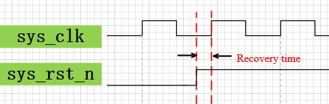
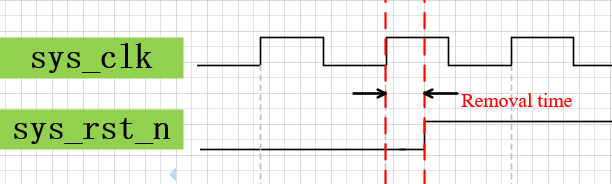
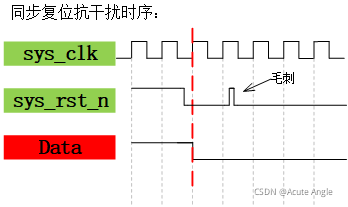
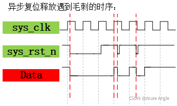
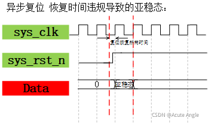
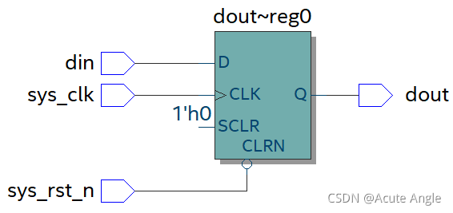
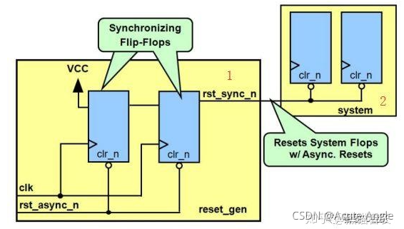

# 异步复位同步释放

### 恢复时间和清除时间

复位恢复时间（recovery time）：撤销复位时，复位信号无效到**时钟有效沿来临之间**需要维持的最小的时间，类似于同步时钟的建立时间setup time；



复位清除时间（removal time）：复位时，在**时钟有效沿来临之后**复位信号还需要保持复位状态的时间为去除时间，类似于同步时钟的保持时间hold time；



‍

### 同步复位

指的是加到所有功能触发器上的复位信号完全同步于时钟信号源。复位信号只有在时钟上升沿到来时，才能有效

优点

- 一般能够确保电路是百分之百同步的。
- 确保复位只发生在有效时钟沿，可以作为过滤掉毛刺的手段。

缺点

- 同步复位依赖于时钟，如果电路中的时钟信号出现问题，无法完成复位。
- 对复位信号的脉冲宽度有要求，必须大于指定的时钟周期，由于线路上的延迟，可能需要多个时钟周期的复位脉冲宽度，且很难保证复位信号到达各个寄存器的时序
- 由于大多数的厂商目标库内的触发器都只有异步复位端口，采用同步复位的话，就会耗费较多的逻辑资源。



###### 异步复位

复位信号直接接到功能触发器的异步复位引脚，复位只与复位信号有关，与时钟无关。无论时钟沿是否到来，只要复位信号有效，就对系统进行复位。

**异步复位特点：**

1. 无需额外的逻辑资源，实现简单，可以保证复位信号到达各个寄存器的时钟偏斜最小；
2. 复位信号易受外界干扰，对电路内的毛刺敏感；  



1. xxxxxxxxxx //使用移位寄存器设计检测“1001”的序列检测器//可重叠检测序列“1001”module sequence_detect(    input       clk,    input       rst_n,    input       seq_in,    output reg  mismatch    //时序逻辑中需要定义为reg型    );​reg [3:0]       seq_in_r;   //定义一个寄存器缓存数据​//使用时序逻辑完成复位和移位寄存器移位过程always@(posedge clk or negedge rst_n) begin    if (!rst_n) begin         seq_in_r <= 4'b0;                           //中间寄存器复位    end    else begin        seq_in_r <= {seq_in_r[2:0],seq_in};         //输入数据置于数组右端，移位寄存器左移位    endend​//使用时序逻辑完成复位与输出always@(posedge clk or negedge rst_n) begin    if (!rst_n) begin         mismatch <= 1'b1;    end    else if (seq_in_r == 4'b1001) begin     //若检测到1001则将mismatch置1，表明检测到序列1001        mismatch <= 1'b0;    end    else begin        mismatch <= 1'b1;                   //养成良好代码风格，不能遗漏，防生成latch，可通过赋初值避免    end end​endmoduleverilog

   

```verilog
module Async_rst(
	input	sys_clk,
	input	sys_rst_n,

	input	din,
	output	reg dout
	);

	always@(posedge sys_clk,negedge sys_rst_n) begin
		if(!sys_rst_n)
			dout <= 1'b0;
		else
			dout <= din;
	end
endmodule

```



###### 异步复位、同步释放

系统设计采用“异步复位、同步释放”（复位信号低电平有效），是利用同步复位和异步复位优点的折中。外部复位信号reset_n异步复位后，rst_n将拉低，即实现异步复位。当复位信号reset_n撤除时，由于双缓冲电路（双寄存器）的作用，rst_n复位信号不会随着reset_n的撤除而撤除。



当异步复位无效（rst\_async\_n \= 1）时，同步后的复位信号 rst\_sync\_n 也为 1；  
    当异步复位有效（rst\_async\_n \= 0）时，同步后的复位信号 rst\_sync\_n 立刻为 0，即实现了“异步复位”，但是会在时钟上升沿来临时恢复为 1，实现“同步释放”；

第一级触发器的输入 D 接电源，即高电平1’b1。  
    第一级触发器的输出，很可能存在亚稳态，使用两级触发器做同步。


```verilog
module rst_sync(
	input clk,
	input rst_async_n,
	output rst_sync_n
);
	reg rst_n_1;
	reg rst_n_2;
	always @ (posedge clk or negedge rst_async_n) 
	begin 
		if( !rst_async_n ) begin 
			rst_n_1 <= 1'b0;
			rst_n_2 <= 1'b0;
		end 
		else begin 
			rst_n_1 <= 1'b1;
			rst_n_2 <= rst_n_1;
		end 
	end 

	assign rst_sync_n = rst_n_2;

endmodule
```
