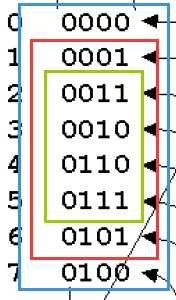
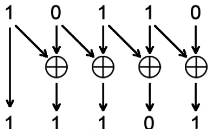
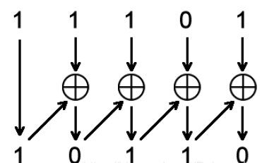
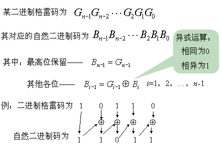

# 格雷码

格雷码（Gray code）是一种二进制数码系统，格雷码的特点是从一个数变为相邻的一个数时，只有一个数据位发生跳变，由于这种特点，就可以*避免二进制编码计数组合电路中出现的亚稳态*。在某些应用中，格雷码具有排除歧义和减少数据传输错误的功能。

格雷码的性质：1、相邻两个数只有一个BIT不同；2、去掉首位相同个数的位数后剩下的数仍满足相邻数只有一个bit不同



#### 自然二进制数转格雷码

从自然二进制码到格雷码的转换具体方法是：从二进制的最低位起，依次起与相邻左边的一位数进行异或逻辑运算，并且作为对应格雷码该位的值，最高位保持不变。*简而言之就是，将二进制码与逻辑右移的二进制码进行*​***异或***​*可得到格雷码*​ ***。***



```verilog
//自然二进制数转格雷码
module bin2gray #(
    parameter width = 4	//定义数据的位宽参数为4
  )(
    input  [width-1:0] bin,
    output [width-1:0] gray
  );

//二进制数逻辑右移与自身进行异或逻辑运算
assign gray = (bin >> 1) ^ bin;

endmodule
```

#### 格雷码转自然二进制数

从格雷码到二进制码的转换具体的方法就是：从格雷码左边第二位（次高位），将每一位与其左边一位解码后的值进行**异或**，作为当前格雷码的值，而最左边一位（最高位）的解码结果就是它本身。*简而言之就是，最高位不变，与二进制数左边一位数异或可得到当前位二进制数*​ ***。***





```verilog
//格雷码转自然二进制数
module gray2bin #(
    parameter width = 4	//定义数据的位宽参数为4
  )(
    input   [width - 1 : 0]  gray,
    output  [width - 1 : 0]  bin
  );

  //利用generate for逐位循环输出最低位至次高位二进制数
  genvar i;
  generate
    for(i = width - 2; i >= 0; i = i - 1) begin
        assign bin[i] = bin[i + 1] ^ gray[i];  //格雷码与二进制数前一位进行异或逻辑运算
    end
  endgenerate

  //二进制数最高位为格雷码最高位
  assign bin[width - 1] = gray[width - 1];

endmodule
```

‍
