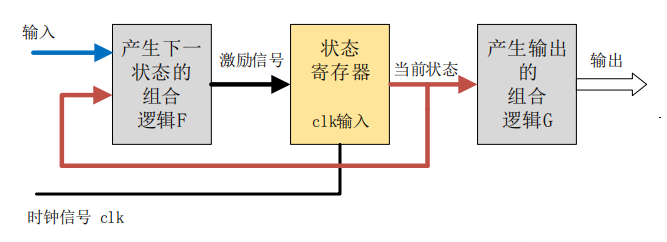
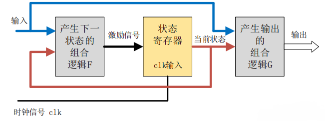

# 状态机

#### Moore 型状态机

Moore 型状态机的**输出**只与<u>当前状态</u>有关，与当前输入无关。

输出会在一个完整的时钟周期内保持稳定，即使此时输入信号有变化，输出也不会变化。输入对输出的影响要到下一个时钟周期才能反映出来。这也是 Moore 型状态机的一个重要特点：输入与输出是隔离开来的。

#### Mealy 型状态机

Mealy 型状态机的**输出**，不仅与<u>当前状态</u>有关，还取决于<u>当前的输入信号</u>。

Mealy 型状态机的输出是在输入信号变化以后立刻发生变化，且输入变化可能出现在任何状态的时钟周期内。因此，同种逻辑下，Mealy 型状态机输出对输入的响应会比 Moore 型状态机早一个时钟周期。

‍

根据状态机的实际写法，状态机可以分为一段式、二段式和三段式状态机。

- 一段式状态机

  整个状态机写到一个 always模块里面，在该模块中既描述状态转移，又描述状态的输入和输出。
- 二段式状态机

  用两个 always 模块来描述状态机，其中一个 always模块采用同步时序描述状态转移；另一个模块采用组合逻辑判断状态转移条件，描述状态转移规律以及输出。不同于一段式状态机的是，它需要定义两个状态，现态和次态，然后通过现态和次态的转换来实现时序逻辑。
- 三段式状态机

  在两个 always 模块描述方法的基础上，使用三个always 模块，一个always 模块采用同步时序描述状态转移，一个 always 采用组合逻辑判断状态转移条件，描述状态转移规律，另一个 always 模块描述状态输出。

‍
