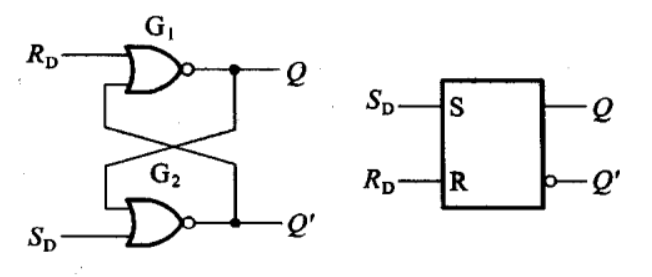
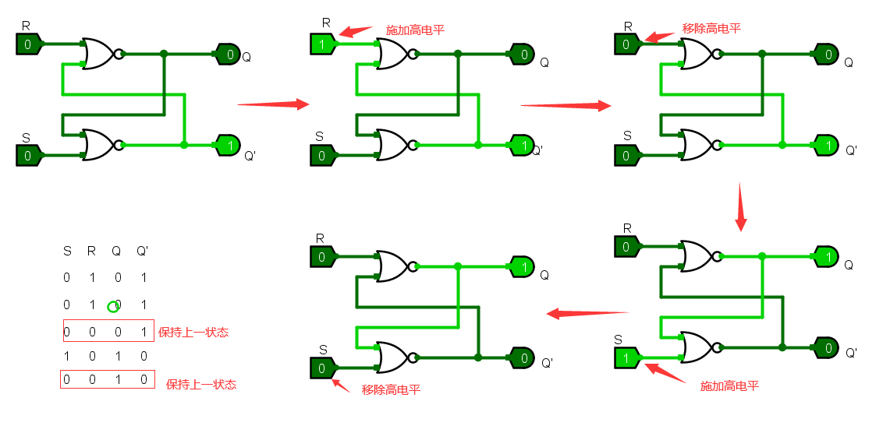
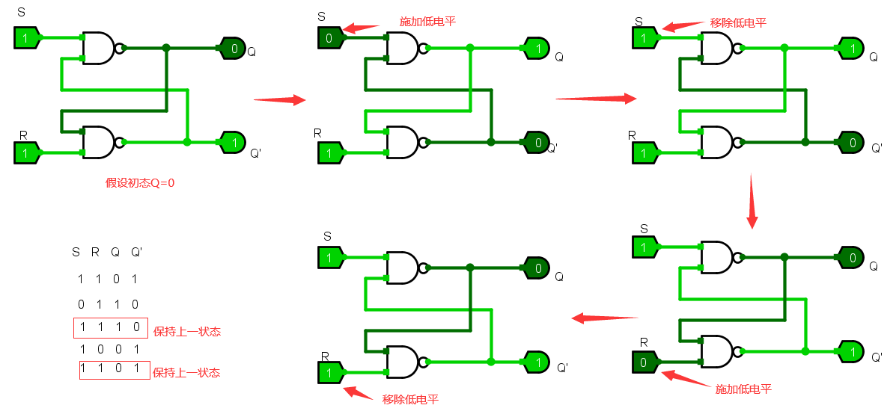
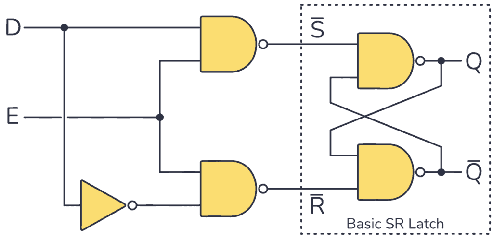
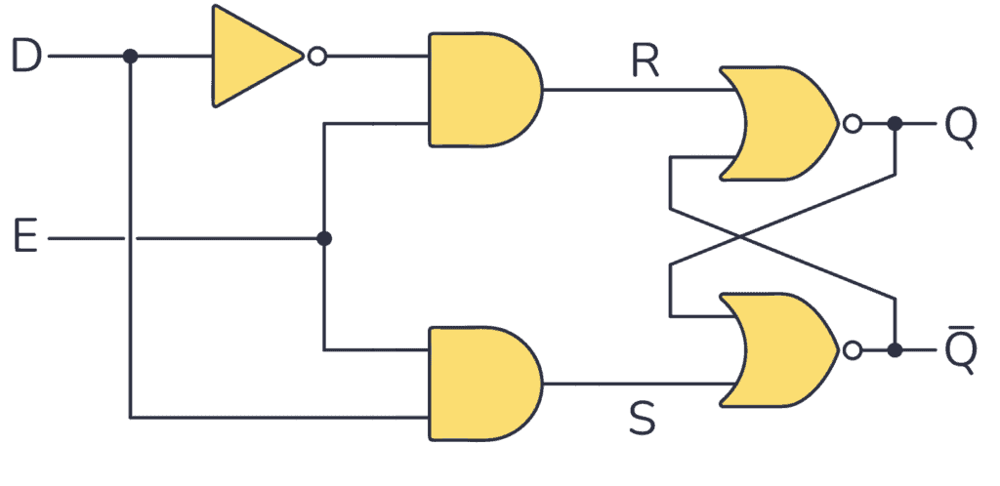
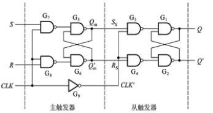
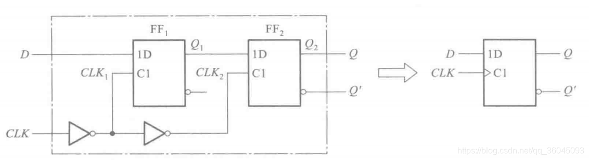
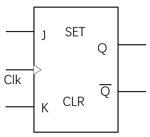
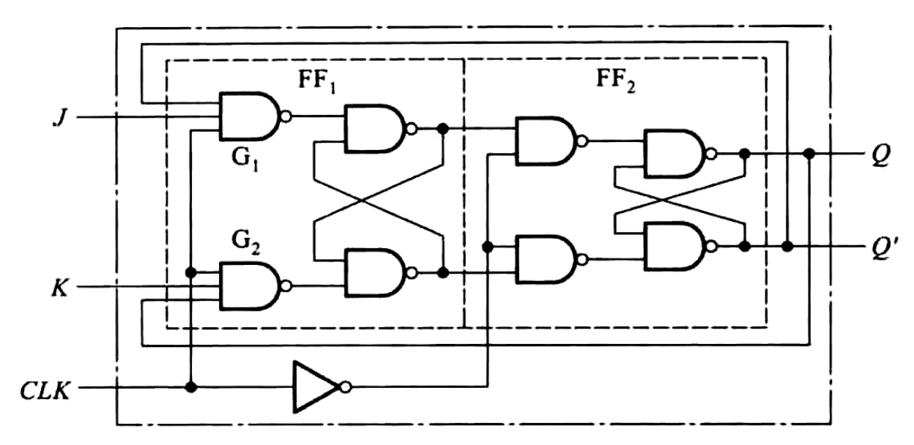

# 触发器

[四种常见触发器（RS触发器、JK触发器、D触发器、T触发器）的基本逻辑及其状态 - asandstar - 博客园 (cnblogs.com)](https://www.cnblogs.com/asandstar/p/16942910.html)

## 锁存器

#### SR锁存器

SR锁存器（Set-Reset Latch）属于静态存储单元的一种。一般由两个**或非门**或**与非门**组成。




其中R表示Reset（复位），S表示Set（复位）。

Q和Q‘称为输出端，并且定义Q\=1、Q’\=0为锁存器的 “ 1 ” 状态;反之为锁存器的 “ 0 ” 状态。

##### NOR型SR锁存器



|S|R|Q|Q’|功能|
| :-: | :-: | :------------: | :------------: | :-------: |
|0|0|保持上一状态|保持上一状态|保持|
|0|**1**|0|1|置0（**Reset**）|
|**1**|0|xxxxxxxxxx //使用移位寄存器设计检测“1001”的序列检测器//可重叠检测序列“1001”module sequence_detect(    input       clk,    input       rst_n,    input       seq_in,    output reg  mismatch    //时序逻辑中需要定义为reg型    );​reg [3:0]       seq_in_r;   //定义一个寄存器缓存数据​//使用时序逻辑完成复位和移位寄存器移位过程always@(posedge clk or negedge rst_n) begin    if (!rst_n) begin         seq_in_r <= 4'b0;                           //中间寄存器复位    end    else begin        seq_in_r <= {seq_in_r[2:0],seq_in};         //输入数据置于数组右端，移位寄存器左移位    endend​//使用时序逻辑完成复位与输出always@(posedge clk or negedge rst_n) begin    if (!rst_n) begin         mismatch <= 1'b1;    end    else if (seq_in_r == 4'b1001) begin     //若检测到1001则将mismatch置1，表明检测到序列1001        mismatch <= 1'b0;    end    else begin        mismatch <= 1'b1;                   //养成良好代码风格，不能遗漏，防生成latch，可通过赋初值避免    end end​endmoduleverilog|0|置1（**Set**）|
|1|1|0|0|亚稳态|

即NOR型（或非门）SR锁存器为**高电平有效电路**。

##### NAND型SR锁存器



|S|R|Q|Q’|功能|
| :-: | :-: | :------------: | :------------: | :-------: |
|1|1|保持上一状态|保持上一状态|保持|
|1|**0**|0|1|置0（**Reset**）|
|**0**|1|1|0|置1（**Set**）|
|**0**|**0**|0|0|亚稳态|

即NAND型（与非门）SR锁存器为**低电平有效电路**。

#### D锁存器

前面SR触发器当输入S\=0，R\=0时，输出为不稳定非正常态，为解决这个问题，引入了D型触发器。

D锁存器可以分为前级门电路（2个NAND门和一个非门）和后级SR锁存器（NAND门）组成。通常，使能端E接入时钟信号。



还可以构建带有 AND 和 NOR 门的 D 锁存器，如下所示。



因为在 CLK 的有效电平期间输出状态始终跟随输入状态变化，输出与输入的状态保持相同，所以又将这个电路称为 **&quot;透明的 D 型锁存器&quot;（Transparent D-Latch）** 。

锁存器的判断

锁存器很容易在信号上产生毛刺；而且也没有时钟信号，不容易进行静态时序分析。

‍

## 触发器

SR触发器



‍

#### D触发器

D触发器可以由两个D锁存器构成，驱动时钟的相位相反。图中FF1为主锁存器，FF2为从锁存器。​​



- 当CLK=0时：

  CLK1 = 1，主锁存器FF1的电平随输入发生变化

  CLK2 = 0，从锁存器FF2处于锁存状态，输出保持不变

- 当CLK=1时：

  CLK1 = 0，主锁存器FF1处于锁存状态

  CLK2 = 1，从锁存器FF2的电平随输入发生变化

```verilog
//含异步复位和时钟使能的D触发器
module dff(
	input 		clk,
	input		rst_n,
	input		en,
	input 		d,
	output reg 	q
);
	always@(posedge clk or negedge rst_n) begin
		if(!rst_n) begin
			q <= 0;
		end else begin
			if(en) q <= d;
		end
	end
endmodule
```

在实际使用中，D触发器通常由传输门构成。

#### JK触发器

JK触发器由两个输入 **J（置位）** 和 **K（复位）** 、一个时钟输入以及两个 Q 和 Q' 的输出组成。



- 当J\=0，K\=0时，触发器的状态维持不变
- 当J\=0，K\=1时，触发器被置成0
- 当J\=1，K\=0时，触发器被置成1
- 当J\=1，K\=1时，触发器翻转

JK触发器是在同步RS触发器的基础上引入两条反馈线构成，从而规避了SR触发器的亚稳态。

JK触发器将输出反馈到输入端，当J和K输入均为1时，输出端驱动输入，导致输出状态翻转，形成一个T（toggle）触发器。



```verilog
module JK_Trigger (
	input clk,
	input J,
	input K,
	output reg  Q,
	output 		Q1
);
	always@(posedge clk)
	begin
		case({J,K})
			2'b00:Q<=Q;
			2'b01:Q<=2'b0;
			2'b10:Q<=2'b1;
			2'b11:Q<=~Q;
		endcase
	end
	assign Q1=~Q;
endmodule 

```

#### T触发器

T触发器（Toggle Flip-Flop，or Trigger Flip-Flop）只有一个信号输入端T，在时钟有效边沿到来时，T端输入有效信号，则触发器翻转，否则触发器保持不变。

```verilog
module tff(
	input clk,
	input rst_n,
	input T,
	output reg Q
);
	always@(posedge clk or negedge rst_n) begin
		if(!rst) 
			Q<=1'b0;
		else if(T) 
			Q<=~Q;   //当T=1时进行翻转
		else 
			Q<=Q;    //当T=0时保持状态不变
	end
endmodule 

```

‍
