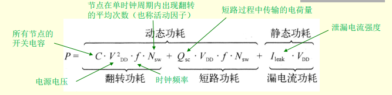
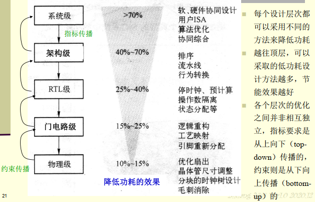
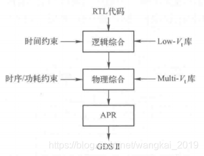
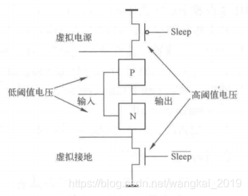
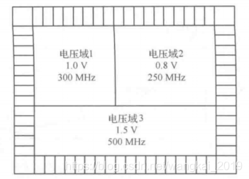
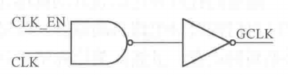
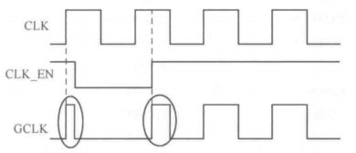
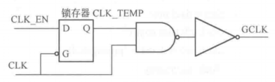
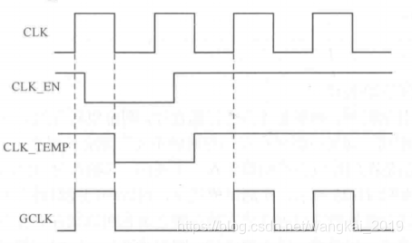
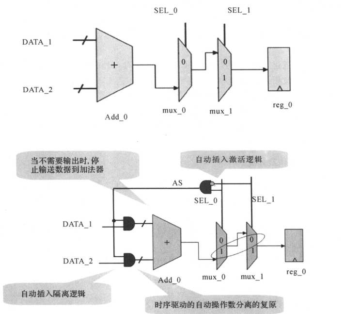

# SOC低功耗设计

## 为什么需要低功耗设计

1、便携式设备——电池寿命。

2、桌面系统——高功耗。

3、高功耗对系统的影响：（1）系统可靠性；（2）系统性能；（3）系统生产及封装成本；（4）系统散热成本。

## 功耗的类型

#### 动态功耗

动态功耗是由翻转电流和短路电流引起的功耗，其中翻转电流引起的功耗称为**翻转功耗**，短路电流引起的功耗称为**短路功耗**，如下图所示。翻转功耗与传输的数据相关（是否有0到1或1到0的变化），翻转功耗在当前的设计电路中仍然占主要部分，短路功耗在动态功耗中所占比例较小。

#### 静态功耗

在CMOS电路中静态功耗主要是由漏电流引起的功耗。

## 不同层次低功耗设计方法

## 静态低功耗技术

#### 多阈值工艺（Multi-Vt Design）方法

低阈值的标准逻辑单元：速度快、漏电流大；

高阈值的标准逻辑单元：速度慢、漏电流小。

一种多阈值工艺的设计流程如下图：

总结：在设计中可以在关键路径上使用低阈值的标准逻辑单元来<u>优化时序</u>，在非关键路径上使用高阈值的标准逻辑单元来<u>优化漏电流</u>。

优点：可以大大减少系统的静态功耗；

          没有任何面积开销，工艺库设计是将两种阈值库中的相应单元的面积设计成一样，这样可以方便替换。

‍

#### 电源门控（Power Gating）方法

‍

## 动态低功耗技术

#### 多电压域（Multi-Voltage Domain）

对于多电压域设计，要在不同的电压域之间使用一些电平转换单元（Level Shifter），将输入电压范围转换成输出需要的不同电压范围。

#### 门控时钟（Clock Gating）

上图所示的门控时钟可能会产生毛刺。

使用锁存器的门控时钟可以避免毛刺。

#### 操作数分离（Operand Isolate）

操作数隔离（简称OI）的核心思路是在不需要计算的时候，使用使能控制信号将输入数置于某一个固定值，使之不再进行计算，从而降低动态功耗~实现方式可以使用RTL编码的实行或者是指导综合工具（新思的Power Compiler）来执行。

‍
