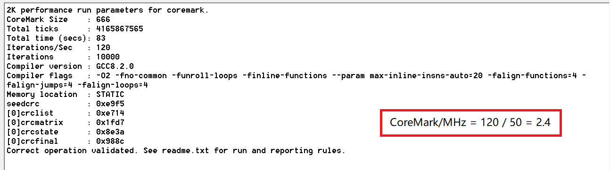
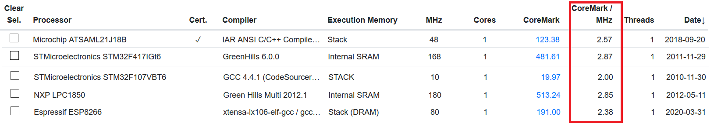
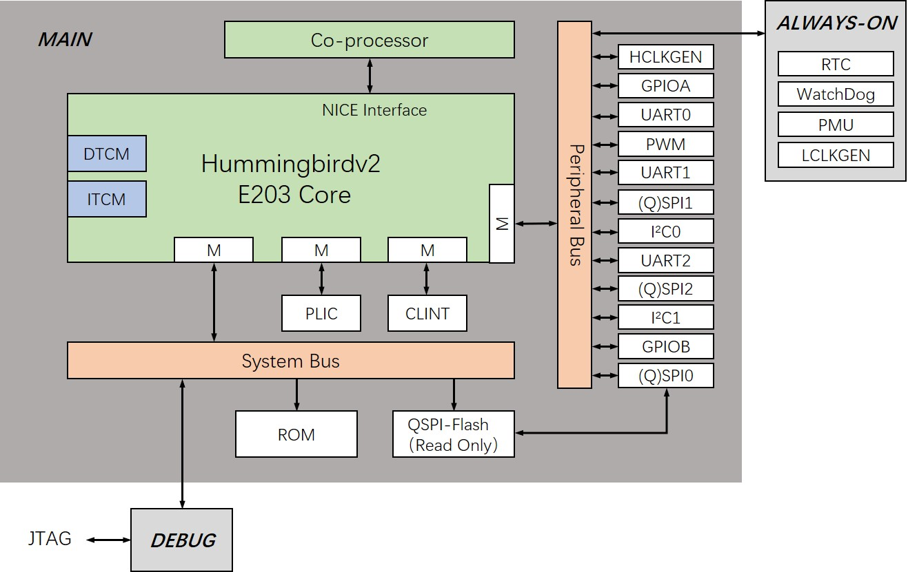
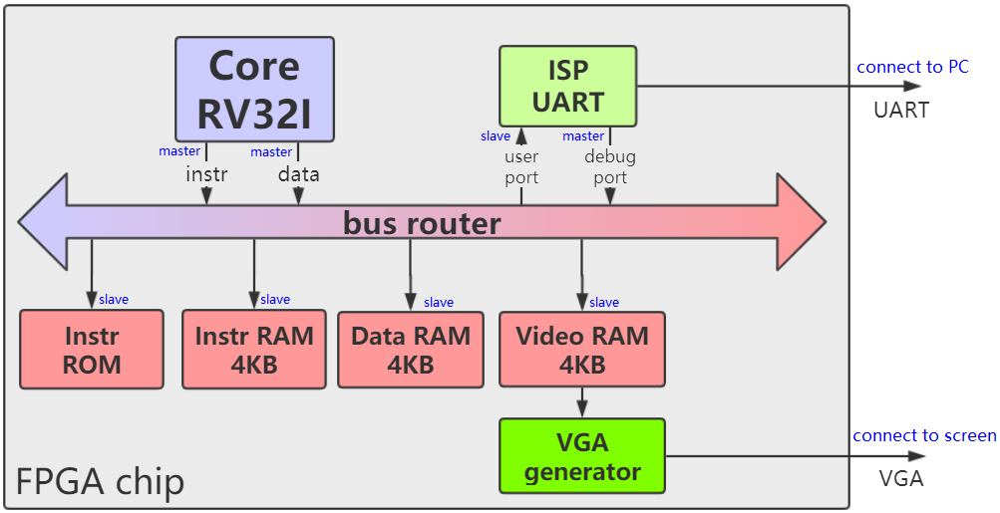

# tinyrisc-v

[tinyriscv: 一个从零开始写的极简、非常易懂的RISC-V处理器核。](https://gitee.com/liangkangnan/tinyriscv)

本项目实现的是一个单核32位的小型RISC-V处理器核(tinyriscv)，采用**verilog语言**编写。设计目标是对标ARM Cortex-M3系列处理器。tinyriscv有以下特点：

1. 支持RV32IM指令集，通过RISC-V指令兼容性测试；
2. 采用三级流水线，即取指，译码，执行；
3. 可以运行C语言程序；
4. 支持JTAG，可以通过openocd读写内存(在线更新程序)；
5. 支持中断；
6. 支持总线；
7. **支持FreeRTOS**；
8. 支持通过串口更新程序；
9. 容易移植到任何FPGA平台(如果资源足够的话)；

目前tinyriscv在Xilinx Artix-7 35T FPGA平台(时钟50MHz)上运行**CoreMark跑分**程序的结果如下图所示：

可知，tinyriscv的跑分成绩为2.4。

选了几款其他MCU的跑分结果如下图所示：

更多MCU的跑分结果，可以到[coremark](https://gitee.com/link?target=https%3A%2F%2Fwww.eembc.org%2Fcoremark%2Fscores.php)官网查询。

# 蜂鸟E203 SOC

[e203_hbirdv2: The Ultra-Low Power RISC-V Core](https://gitee.com/riscv-mcu/e203_hbirdv2)

[Hummingbirdv2 E203 Core and SoC — Hummingbirdv2 E203 Core and SoC 0.2.1 documentation](https://doc.nucleisys.com/hbirdv2/index.html)

蜂鸟 E203 是**芯来科技开源的 32 位 RISC-V 处理器内核**，是国内最早完整开源的 RISC-V 处理器之一，主打极致低功耗与极小面积，定位对标 ARM Cortex-M0/M0+，是嵌入式 MCU、IoT 节点场景的主流开源选型，也是高校处理器教学的经典入门项目。

E203 的设计核心是「在满足嵌入式控制基本需求的前提下，追求面积与功耗的极致优化」，采用极简架构设计，放弃复杂流水线与乱序执行，专注于低功耗、小尺寸、高确定性的嵌入式场景，非常适合电池供电的终端设备和资源受限的控制场景。

1. **指令集架构**
   - 标准支持 **RV32IMAC**，可选配置为 RV32EMAC（16 个通用寄存器的嵌入式精简版）
   - 自带 NICE 协处理器扩展接口
2. **流水线与架构**
   - 经典**2 级流水线**（取指 + 执行 / 写回），哈佛架构，指令与数据存储器分离
   - 仅支持**机器模式（Machine Mode）**，无 S/U 特权模式，无 MMU 内存管理单元，匹配 MCU 类嵌入式场景的需求
   - 可配置 ITCM（指令紧耦合存储器）、DTCM（数据紧耦合存储器），默认各 64KB，访问无延迟
3. **性能、功耗与面积**
   - 主频：65nm 工艺下最高可达 200MHz
   - 芯片面积：65nm 工艺下仅**0.015mm²**，是面积最小的 RISC-V 内核之一
   - 功耗：典型运行功耗低于 100μW，支持多级睡眠模式，静态功耗极低
   - 性能：CoreMark 评分约 200 分，达到 Cortex-M0 + 同级水平

官方不仅提供处理器内核源码，还输出了完整的片上系统参考方案与开发工具链。

- **片上外设**：集成 UART、GPIO、I2C、SPI、PWM、RTC、看门狗、定时器等常用 MCU 外设，适配绝大多数嵌入式控制需求
- **中断系统**：内置 CLINT 核心本地中断控制器 + PLIC 平台级中断控制器，支持定时器中断与外部外设中断
- **调试能力**：兼容 RISC-V 标准调试规范，支持 JTAG/SWD 调试接口，可搭配 GDB 进行单步、断点调试
- **开发套件**：配套 HBird SDK，包含完整的驱动库、示例工程，原生支持 FreeRTOS 等实时操作系统
- **FPGA 支持**：官方提供 Xilinx Artix-7 等主流 FPGA 开发板的参考工程，可快速搭建硬件原型GitHub

#  USTC-RVSoC

[Dr.W.X/USTC-RVSoC - 码云 - 开源中国](https://gitee.com/wangxuan95/USTC-RVSoC)

一个 SystemVerilog 编写的，以一个 RISC-V CPU 为核心的，普林斯顿结构的 SoC ，可作为 MCU 使用。

- **CPU**：5段流水线 RISC-V ，支持 **RV32I** 指令集（除了 CSR 指令）。
- **总线**：具有**握手机制**，32-bit地址，32-bit数据。
- **总线交叉开关 (bus router)**：可使用参数修改总线主从接口的数量和从接口占用的地址空间，以方便拓展外设。
- **交互式 UART 调试**：可使用PC上的 Putty、minicom、超级终端等软件进行在线系统复位**、**上传程序**、**查看内存。
- 完全使用 SystemVerilog 实现，不调用IP核，便于移植和仿真。

下图展示了SoC的结构，总线仲裁器 **bus_router** （也叫总线交叉开关）上挂载了3个**主接口**（master port）和5个**从接口**（slave port）。这个总线并不来自于任何现有标准（例如 AXI 或 APB），而是一种简单的同步握手总线，命名为 **naive_bus**。

