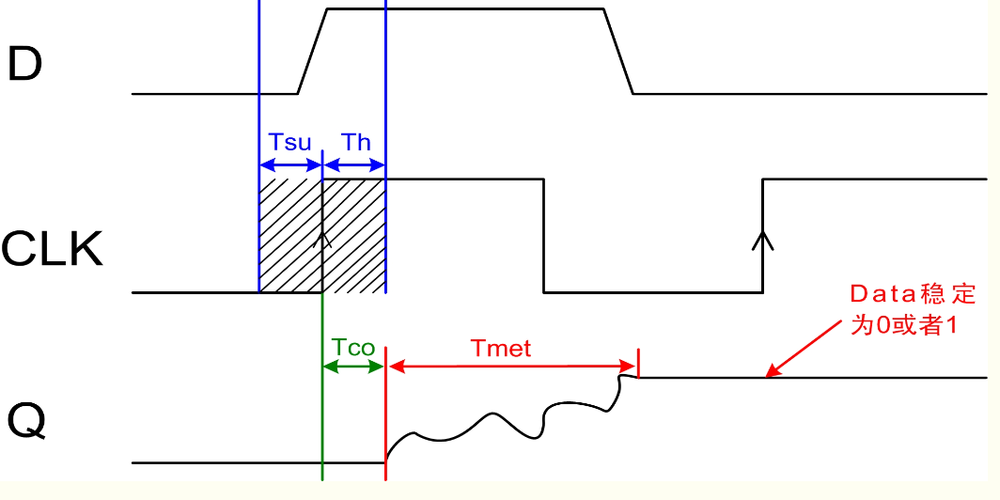
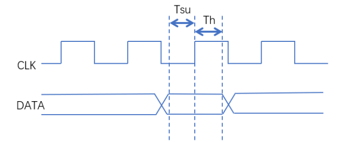
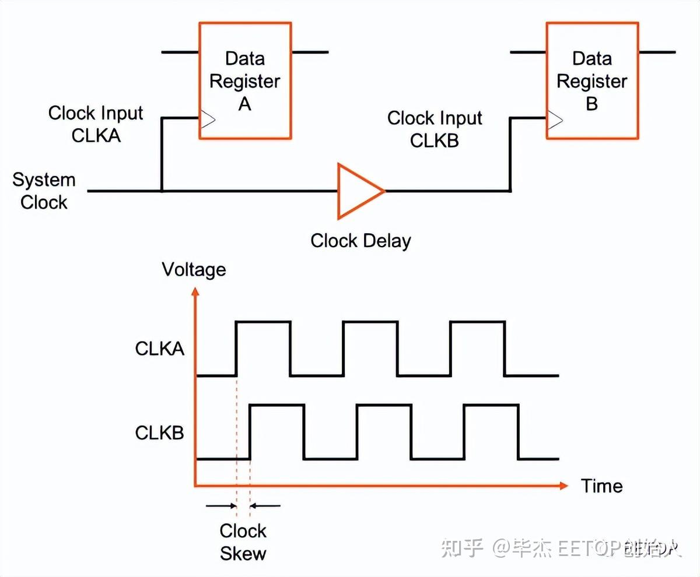
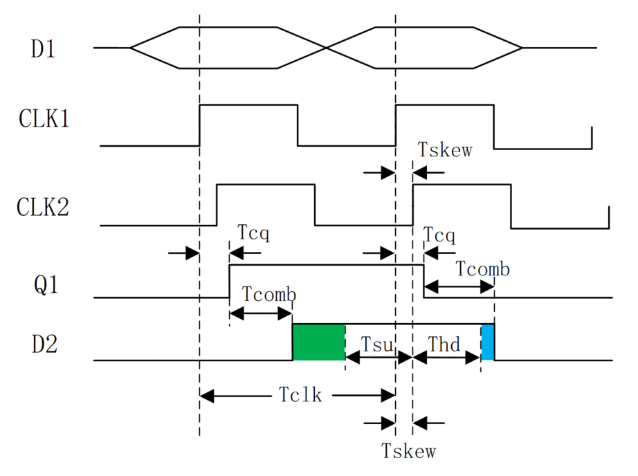
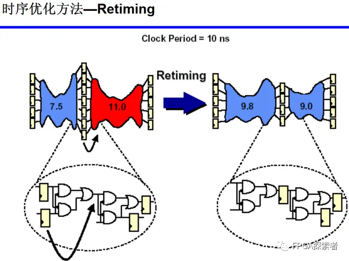
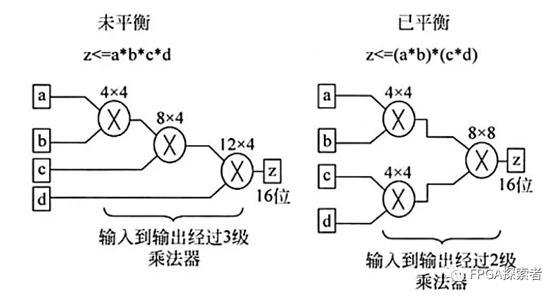
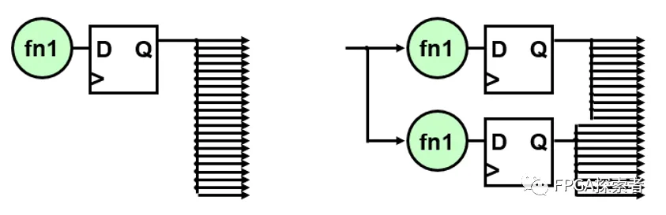

# 静态时序分析

### 亚稳态定义

每一个触发器都有其规定的建立(setup)和保持(hold)时间参数, 在这个时间参数内， 输入信号在时钟的上升沿是不允许发生变的。 如果在信号的建立时间中对其进行采样， 得到的结果将是不可预知的，即亚稳态。

此时触发器输出端Q在有效时钟沿之后比较长的一段时间处于不确定的状态，在这段时间里Q端在0和1之间处于振荡状态，而不是等于数据输入端D的值。这段时间称为决断时间（resolution time）。经过resolution time之后Q端将稳定到0或1上，但是稳定到0或者1，是随机的，与输入没有必然的关系。



触发器进入亚稳态的时间可以用参数 MTBF(mean time between failures)来描述， MTBF即触发器采样失败的时间间隔，其公式描述如下：

$$
MTBF = \frac{1}{T_0fa}e^{\frac{t_r}{\tau}}
$$

其中，

- $t_r$：分辨时间（时钟沿开始）

- $\tau,T_0$：触发器参数

- $f$：采样时钟频率

- $a$：异步事件触发频率

通常，MTBF越大说明系统采样失败的可能越小。可见，对于高速的设计，亚稳态是更容易发生的。

- 使用同步器，如2级或多级FF打拍。
- 降低频率。
- 避免变化过快或过于频繁的信号进行跨时钟采样。
- 采用更快的触发器。
- 使用双锁存器法，在一个信号从一个时钟域进入另一个时钟域之前，将该信号用新时钟域控制的两个锁存器连续锁存两次。

### 建立时间与保持时间

对于某个DFF来说，建立时间和保持时间可以认为是此器件固有的属性。

###### 建立时间（T<sub>su</sub>：set up time）　　

　　是指在触发器的时钟信号**上升沿到来以前**，数据稳定不变的时间，如果建立时间不够，数据将不能在这个时钟上升沿被稳定的打入触发器，T<sub>su</sub>就是指这个最小的稳定时间

###### 保持时间（T<sub>h</sub>：hold time）　　

　　是指在触发器的时钟信号**上升沿到来以后**，数据稳定不变的时间，如果保持时间不够，数据同样不能被稳定的打入触发器，Th就是指这个最小的保持时间。

可以通俗的理解为：时钟到来之前，数据需要提前准备好；时钟到来之后，数据还要稳定一段时间。建立时间和保持时间组成了数据稳定的窗口。



###### 建立时间约束

时钟到来之前，数据需要提前准备好，才能被时钟正确采样，要求数据路径 （data path） 比时钟路径 （clock path）更快。

$$
T_{cq} + T_{comb} + T_{su}  + T_{skew} < T_{clk}
$$

- Tcq: 寄存器 clock 端到 Q 端的延迟；
- Tcomb： data path 中的组合逻辑延迟；
- Tsu: 建立时间；
- Tclk: 时钟周期；
- Tskew: 时钟偏移。其中skew采用如下方式规定正负号。

  

```shell
最小时钟周期 = Tcq + Tcomb + Tsu + Tskew
最快时钟频率 = 1 / (Tcq + Tcomb + Tsu + Tskew) 
```

时钟到来之后，数据还要稳定一段时间，这就要求前一级的数据延迟（data delay time）不要大于触发器的保持时间。

$$
T_{cq} + T_{comb} >= T_h + T_{skew}
$$

- Tcq: 寄存器 clock 端到 Q 端的延迟；
- Tcomb： data path 中的组合逻辑延迟；
- Thd: 保持时间；
- Tskew: 时钟偏移。

上述两个式子可通过下图理解。

```shell
建立时间裕量为：（时钟路径时间）-（数据路径时间）
保持时间裕量为：（数据延迟时间） - （保持时间 + 时钟偏移）
```



问题：

- 如果DFF的hold时间不满足，能否通过降低时钟频率来解决？（×）

- setup time与hold time是否可能为0？（√）

### 时序违例的解决方案

1. **组合逻辑中插入寄存器（插入流水线）**   

   组合逻辑的延时过长，就会成为关键路径，这时可以考虑在该路径上插入额外的寄存器，这种方法也称为插入流水线。当然，其不可避免地会带来部分面积的增加。
2. **寄存器平衡（重定时Retiming）**

   在不增加寄存器个数的前提下，通过改变寄存器的位置来优化关键路径，可以对比和流水线插入寄存器的不同。

   
3. **操作符平衡（加法树、乘法树）**

   平衡前，a和b均经过3个乘法器带来的延时，c经历2个，d经历1个，最长延时为3个乘法器延时。平衡后，树形结构，a、b、c、d均经历2个乘法器延时，最长延时为2个乘法器延时。

   
4. **消除代码优先级（case代替if…else）**   
   本身确实不需要优先级的地方，可以使用case代替if…else，使得顺序执行的语句编程并行执行。如果确实有优先级兵，则不能这样做。这种消除代码中的优先级的策略也称为代码结构平坦化技术，主要针对那些带优先级的编码结构。
5. **逻辑复制**  
   当某个信号的扇出fanout比较大时，会造成该信号到各个目的逻辑节点的路径变得过长，从而成为设计中的关键路径，此时可以通过对该信号进行复制来降低扇出。高扇出的危害是大大增加了布局布线的难度，这样其扇出的节点也就无法被布局得彼此靠近，所以就导致了布线长度过大的问题。

   

‍
