[安装 Synopsys 2024 EDA (RockyLinux8.10) - ZhengQC - 博客园](https://www.cnblogs.com/ZhengQC/p/19065647#1)

[VMware中Linux虚拟机配置本地共享文件夹_linux虚拟机共享文件夹-CSDN博客](https://blog.csdn.net/weixin_44149170/article/details/156270335)

[Synopsys2024安装教程_synopsysmonoslayer-CSDN博客](https://blog.csdn.net/weixin_43444334/article/details/147316674)

[(99+ 封私信 / 80 条消息) Synopsy2020以上版本EDA软件安装教程 - 知乎](https://zhuanlan.zhihu.com/p/599939753)

[Synopsys2024安装教程_synopsysmonoslayer-CSDN博客](https://blog.csdn.net/weixin_43444334/article/details/147316674) （亲测有效）

## 安装Almalinux系统

官网下载页面地址

https://almalinux.org/zh-hans/get-almalinux/


AlmaLinux 8.x镜像直接下载地址，我这用了镜像站

https://mirrors.sjtug.sjtu.edu.cn/almalinux/8.10/isos/x86_64/AlmaLinux-8-latest-x86_64-dvd.iso

如果基于WSL2安装，可使用如下命令


## 系统初始化配置

打开终端，输入如下命令查看ip地址

```shell
ip addr
```

### 更换国内镜像源

查看AlmaLinux 现有镜像源路径

```shell
ll /etc/yum.repos.d/
```


替换前首先备份镜像源

```bash
sudo cp -r /etc/yum.repos.d /etc/yum.repos.d.bak
```

输入如下命令，批量替换为阿里源

```bash
sudo sed -e 's|^mirrorlist=|#mirrorlist=|g' \
    -e 's|^# baseurl=https://repo.almalinux.org|baseurl=https://mirrors.aliyun.com|g' \
    -i.bak \
    /etc/yum.repos.d/almalinux*.repo
```

清理并更新缓存

```bash
sudo dnf clean all
sudo dnf makecache 
```

### 安装其他必要的开发软件

更新系统软件包

```bash
sudo dnf update -y
```

安装 EPEL

```bash
sudo dnf config-manager --set-enabled powertools
sudo dnf -y install epel-release
```

安装EDA软件必要的软件包

```bash
sudo dnf groupinstall -y "Development Tools"
sudo dnf install -y vim libXScrnSaver libmng redhat-lsb redhat-lsb.x86_64 libpng12 pcre pcre-devel ksh tcsh csh tcl tk tcl-devel tk-devel
sudo dnf install -y libstdc++.i686 glibc.i686 zlib.i686 libXext.i686 libXtst.i686
sudo dnf install -y xcb-util xcb-util-wm xcb-util-image xcb-util-keysyms xcb-util-renderutil
```

安装GCC

```bash
sudo dnf install -y gcc gcc-c++
```

安装make

```bash
sudo dnf install -y make
```

安装curl

```bash
sudo dnf install -y curl
```

安装gvim

```shell
sudo dnf install vim-X11 -y
```

安装gedit

```shell
sudo dnf install gedit -y
```

安装VS Code

https://code.visualstudio.com/updates/

AlmaLinux的软件包格式为rpm。获取最新rpm包，然后传入虚拟机安装

```bash
sudo rpm -ivh code-1.111.0-1772846667.el8.x86_64.rpm
```

### 配置FileZilla连接系统（使用虚拟机）

要使用FileZilla连接虚拟机，需确保虚拟机上已安装并运行SSH服务。

**安装并启动SSH服务**

```
sudo dnf install openssh-server
```

安装完成后，启动SSH服务

```
sudo service ssh start
```

检查SSH服务状态

```
sudo service ssh status
```

确保显示为“active (running)”。

**获取虚拟机IP地址**

在终端中输入以下命令获取虚拟机的IP地址

```
ifconfig
```

**配置FileZilla连接**

打开FileZilla，点击“文件”->“站点管理器”，新建站点并选择SFTP协议。输入以下信息：

- 主机：虚拟机的IP地址
- 用户：虚拟机的用户名
- 密码：虚拟机的用户密码
- 端口：22（默认SSH端口）

点击“连接”即可。

### 开启共享文件夹（使用虚拟机）


##### 创建挂载点

在虚拟机中创建一个目录，作为访问共享文件夹的入口。

```bash
sudo mkdir -p /mnt/hgfs
```

##### 执行挂载命令

使用 `vmhgfs-fuse` 工具进行挂载，这是适用于新内核的标准方法。

```bash
sudo vmhgfs-fuse .host:/share /mnt/hgfs -o allow_other
```

> - .host:/share：.host: 代表宿主机，shared 替换为上一步查到的实际共享名称。
> - /mnt/hgfs：本地的挂载点目录。
> - -o allow_other：允许其他用户（非 root）访问该挂载点。
>   挂载成功后，你就可以在 /mnt/hgfs 目录下看到宿主机共享文件夹中的所有文件了。

```bash
ls -l /mnt/hgfs
```

如果想卸载已有挂载，执行如下命令

```shell
sudo umount /mnt/hgfs
sudo umount -l /mnt/hgfs # 若提示 busy，用 lazy unmount
```

##### 设置开机自动挂载

1. 使用你喜欢的文本编辑器打开 /etc/fstab。

```bash
sudo vim /etc/fstab
```

2. 在文件末尾添加以下一行：

```
.host:/share /mnt/hgfs fuse.vmhgfs-fuse defaults,allow_other 0 0
```

> - .host:/shared：共享文件夹的路径，同上。
> - /mnt/hgfs：本地挂载点。
> - fuse.vmhgfs-fuse：指定文件系统类型为 fuse.vmhgfs-fuse。
> - defaults,allow_other：挂载选项，allow_other 确保普通用户可访问。

之后重启系统，若`/mnt/hgfs/`目录中存在share目录，则表示成功


## 安装Synopsys2024

### 安装初始化

初始化空安装目录。安装的目标路径必须为空

```2024
mkdir ~/Synopsys
```

运行SynopsysInstaller_v5.8.run

```
cd Synopsys2024/Installer_5.8/
sudo ./SynopsysInstaller_v5.8.run
```

### 安装 SCL

进入 `installer` 目录，运行 `./setup.sh` 开始安装

  ```shell
  cd $SYNOPSYS_HOME/installer_v5.8
  ./setup.sh
  ```

出现安装界面，点击`Start`

  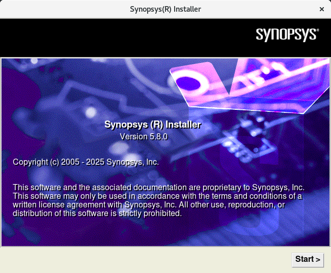

填写信息，默认即可，点击`Next`

  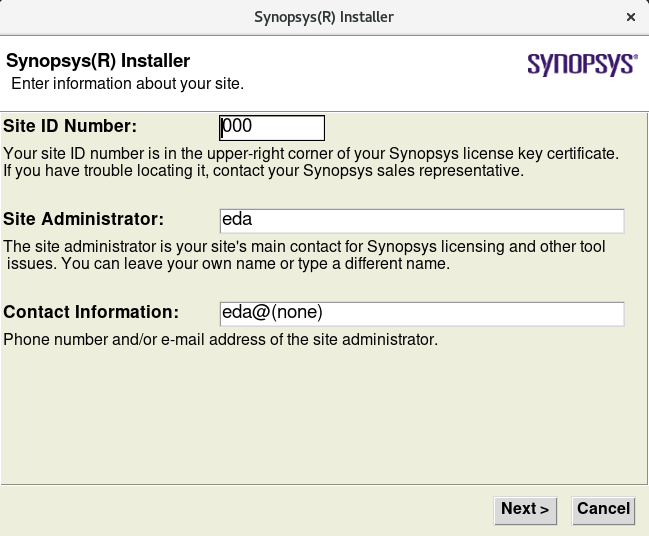

选择SCL的安装源路径，并点击`Next`

SCL的安装源路径的位置为`/mnt/hgfs/Share/Synopsys/scl_v2018.06`

    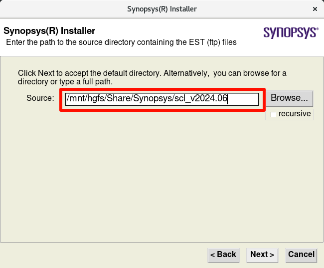

选择SCL的安装目标路径，并点击`Next`

SCL的安装目标路径(Target Dir)的位置为`/home/eda/Synopsys`

    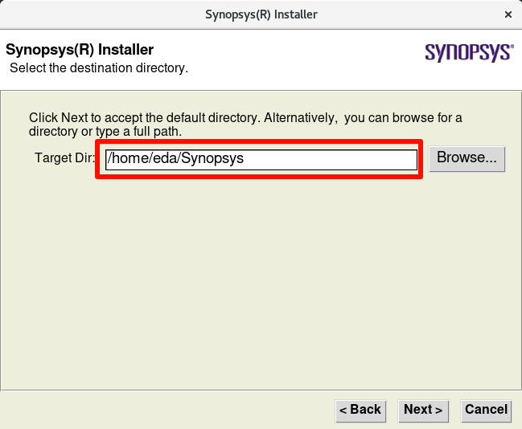

出现如下窗口，点击`Yes`即可

  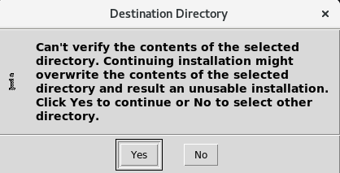

选中安装内容，点击`Next`

  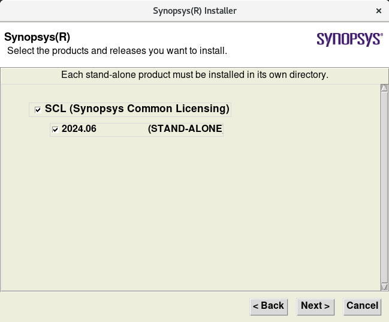

确认安装信息，依次点击`Next`、`Accept,Install`

  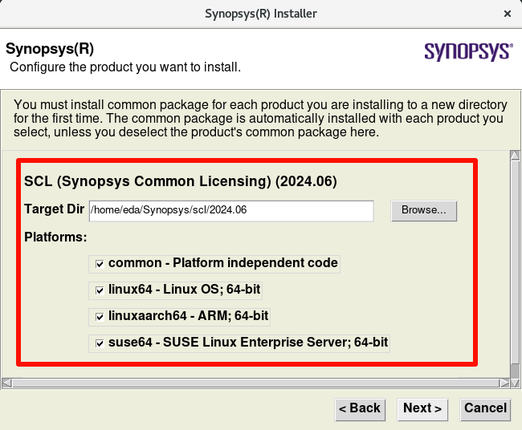
  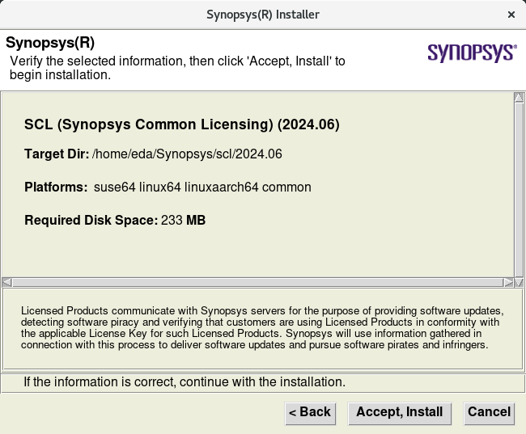

安装完成，点击`Finish`

  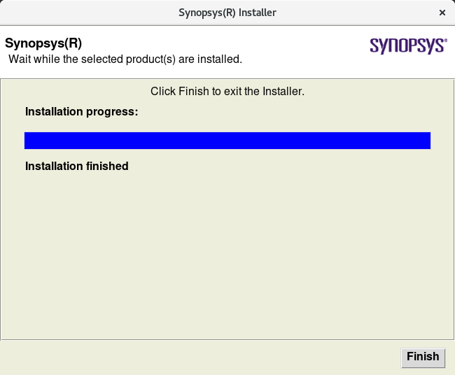

出现`Release Note`窗口，点击`Dismiss`

  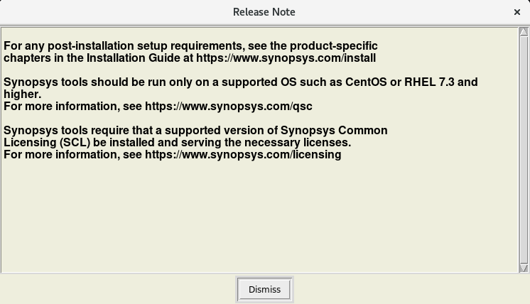

### 安装 VCS

- 安装`VCS`的方式与`SCL`类似；
- `VCS`的安装目标路径(Target Dir)都为`/home/eda/Synopsys`


### Patch/Crack

目前crack工具有多种：

SynopsysMonoSlayer、pubkey_v1.6（里面包含了pubkey_verify、synopsys_checksum）

我们就全部用一遍，每个工具对所有软件的安装目录进行一遍Patch

将以下文件分别拷贝到程序的目录下

```bash
cp -r /home/test/Synopsys2024/Patch_tools/* /home/test/synopsys_2024/scl/2024.06/
ls -l /home/test/synopsys_2024/scl/2024.06/ | grep pubkey_verify
ls -l /home/test/synopsys_2024/scl/2024.06/ | grep synopsys_checksum
ls -l /home/test/synopsys_2024/scl/2024.06/ | grep SynopsysMonoSlayer

cp -r /home/test/Synopsys2024/Patch_tools/* /home/test/synopsys_2024/verdi/W-2024.09-SP1/
ls -l /home/test/synopsys_2024/verdi/W-2024.09-SP1/ | grep pubkey_verify
ls -l /home/test/synopsys_2024/verdi/W-2024.09-SP1/ | grep synopsys_checksum
ls -l /home/test/synopsys_2024/verdi/W-2024.09-SP1/ | grep SynopsysMonoSlayer

cp -r /home/test/Synopsys2024/Patch_tools/* /home/test/synopsys_2024/vcs/W-2024.09-SP1/
ls -l /home/test/synopsys_2024/vcs/W-2024.09-SP1/ | grep pubkey_verify
ls -l /home/test/synopsys_2024/vcs/W-2024.09-SP1/ | grep synopsys_checksum
ls -l /home/test/synopsys_2024/vcs/W-2024.09-SP1/ | grep SynopsysMonoSlayer
```

SCL部分的Patch

```
cd /home/eda/synopsys_2024/scl/2024.06
./pubkey_verify -y
./synopsys_checksum -y
./SynopsysMonoSlayer -a 
```


### 启动scl_keygen生成器

这个需要在window下进行，双击运行scl_keygen.exe.

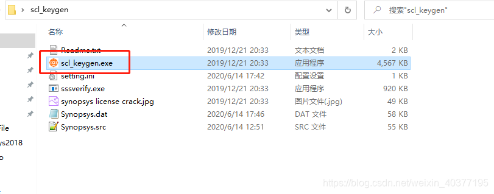

需要填写这4项信息，HOST ID Daemon 和HOST ID Feature填写一样的，Port选择27000。

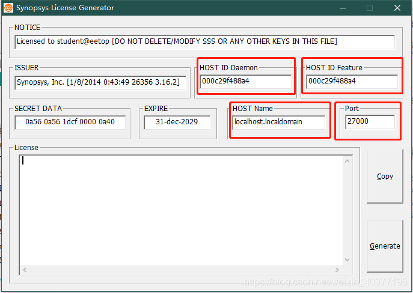

进入虚拟机，打开terminal使用以下命令查找

```bash
hostname
ifconfig
```

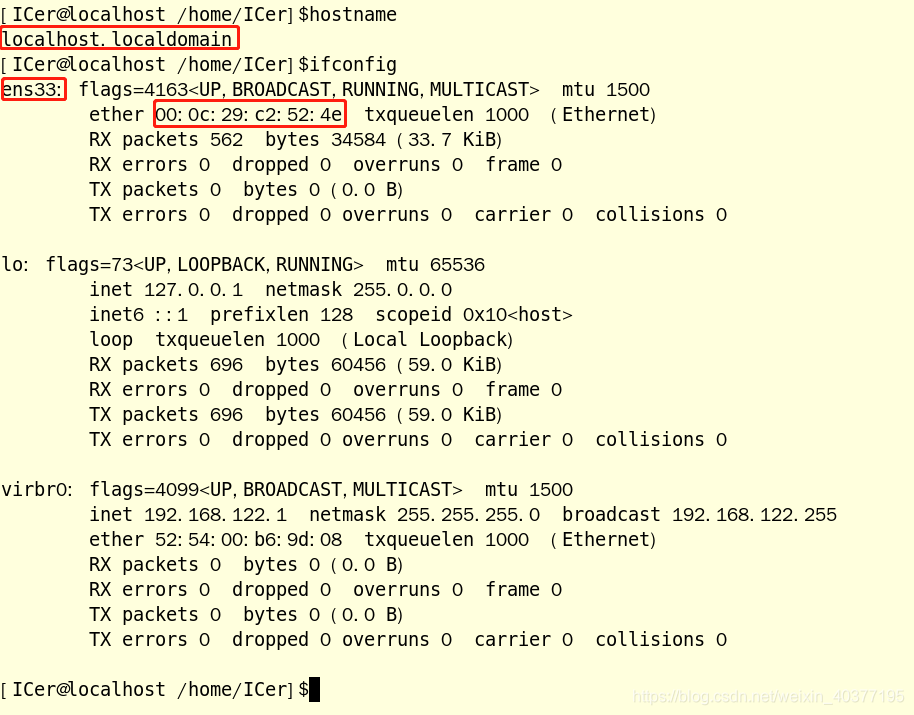

我的填写如下，然后点击Generate生成license

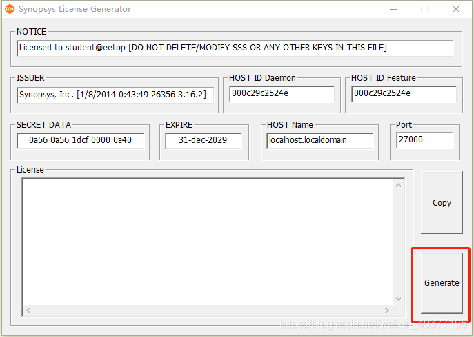

打开生成licens文件，修改第二行，这个需要与虚拟机里面scl路径一致，不然license无效。修改好后把这个文件复制到共享文件中。这个文件最后需要放到这个“scl/2018.06/admin/license/”目录下，要与环境里面设置的路径一致。

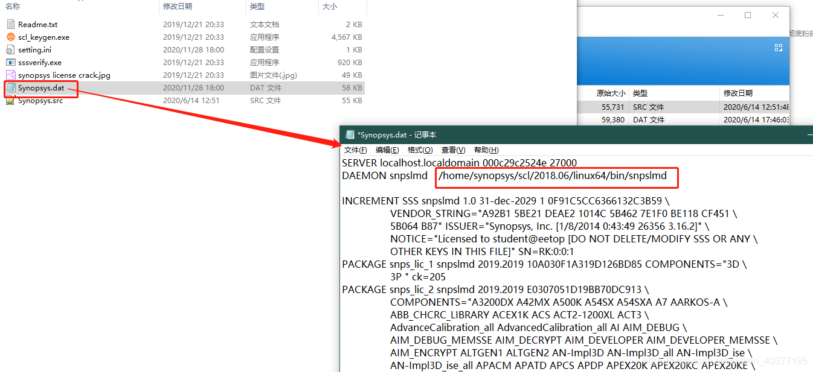

### 环境设置

打开.bashrc环境文件，加入以下内容，对应自己安装路径。但是需要注意倒数第二行，需要确认主机名是否正确。保存退出，source一下。

```bash
export SYNOPSYS_HOME=/home/eda/Synopsys

# SCL
export SCL_HOME=$SYNOPSYS_HOME/scl/2024.06
export PATH=$SCL_HOME/linux64/bin:$PATH
export VCS_ARCH_OVERRIDE=linux

# VCS
export VCS_TARGET_ARCH=amd64
export VCS_HOME=$SYNOPSYS_HOME/vcs/W-2024.09-SP1
export PATH=$PATH:$VCS_HOME/bin

# VERDI
export VERDI_HOME=$SYNOPSYS_HOME/verdi/W-2024.09-SP1
export LD_LIBRARY_PATH=$VERDI_HOME/share/PLI/VCS/linux64:$LD_LIBRARY_PATH
export PATH=$PATH:$VERDI_HOME/bin

# license
export LM_LICENSE_FILE=$SYNOPSYS_HOME/scl/2024.06/admin/license/Synopsys.dat
alias lmg="lmgrd -c $SYNOPSYS_HOME/scl/2024.06/admin/license/Synopsys.dat"

```

### 激活

先使用以下命令设置开放端口：

```bash
firewall-cmd --zone=public --add-port=27000/tcp --permanent
firewall-cmd --reload
```

然后在输入“lmg”进行激活，这个每次启动虚拟机都需要这样操作一下。

激活好后输入“verdi”打开verdi工具，查看是否激活成功，但是这儿有是有错误，使用下面命令进行安装，成功后再输入“verdi”，能够打开verdi，激活成功


### 停止旧 license 服务

```
# 查看是否有残留
ps aux | grep lmgrd
ps aux | grep snpslmd
```

如果有对应进程，直接kill对应ID即可。
