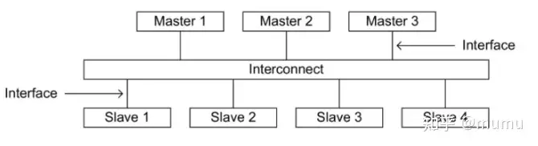
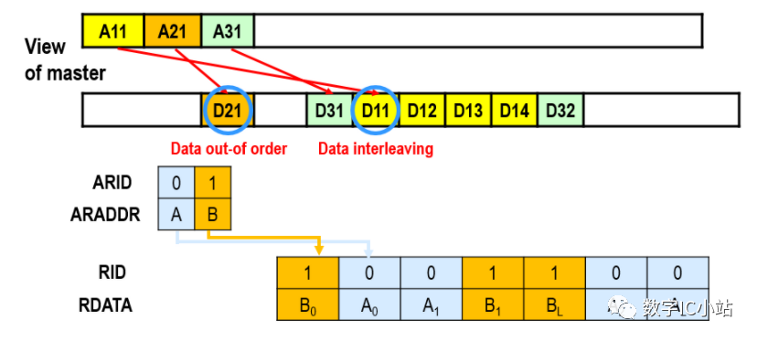

# AXI

[常见的AXI总线仲裁器概述 (qq.com)](https://mp.weixin.qq.com/s?__biz=MzIzMTg4NDM3Mw==&mid=2247484317&idx=1&sn=ac689159074f185f72bb0ba640d1c0c1&chksm=e89c10a7dfeb99b1ef55142817e9449545b1d0d7c8c5e404563e7526874423567d8abb0aa4b1&scene=21#wechat_redirect)

[【003】数字IC笔面试常见题-腾讯云开发者社区-腾讯云 (tencent.com)](https://cloud.tencent.com/developer/article/2084401)

‍

以AXI4为例，有AXI full/lite/stream之分。

在Xilinx系列FPGA及其有关IP核中，经常见到AXI总线接口，AXI总线又分为三种：AXI-Lite，AXI-Full以及AXI-Stream。

AXI-Stream是以数据流的形式传输，无地址。AXI-Lite和AXI-Full都是基于memory map的形式实现数据传输（即包括地址总线）。

AXI-Lite是AXI-Full的简化版，适合小批量的数据传输，常用来进行命令的传输，IP核的初始化等。

AXI-Full则适用于大批量，高性能的数据传输。

## 基本互联结构

AXI总线系统由Master、Slave和Interconnect等基本器件搭建而成，器件间的互联方式如下图所示：

‍

outstanding

Outstanding操作是指Master在前一个操作还没有完成的时候，发出下一个操作或下几个操作。Outstanding操作需要Slave的支持，Slave必须声明可以支持的Outstanding操作的深度，AXI协议兼容不支持Outstanding操作的slave（即Outstanding的深度为1）。

相对于Outstanding操作，Out-of-order操作主要是针对Slave来说的，指Slave返回的数据的顺序与Master发出指令的顺序不一致。造成这种不一致的原因有以下两个：

- Slave之间的响应速度不一致
- 某些复杂的slave接口设计本身支持乱序操作

AXI使用ID来处理乱序，ID由ARID[3:0]信号或AWID[3:0]信号确定。AXI传输顺序需要遵守的规则如下：

- 来自不同Master的传输之间没有顺序要求，可以按任意顺序完成。
- 来自同一Master的不同ID的传输没有顺序要求，可以按任意顺序完成。
- 相同AWID的写数据序列必须和发起该传输的Master确定的写地址顺序一致。
- 相同ARID的读数据序列如果来自同一个Slave，则该Slave必须保证读数据的顺序与其收到地址的顺序一致；如果来自不同的Slave，则Interconnect必须保证读数据的顺序与其收到地址的顺序一致。

## 部分问题

[AXI 面试题1~12 - 知乎 (zhihu.com)](https://zhuanlan.zhihu.com/p/406744795)

**AXI4的burst类型**

1）自增模式，支持的突发传输长度为1-256

2）Fixed模式，每一次突发传输的模式的地址都一样，类似FIFO

3）WRAP Type模式，突发地址经过一个圈之后回到源地址

‍

**为什么一次AXI突发的地址不能跨4K地址**

1）其实原因很简单，因为AXI的AW通道的AWADDR地址的高4bit是对应的AXI主机地址

2）即一个AXI总线最多支持16个主机

3）AXI总线中定义的一个page大小为4kBytes，AXI的所有的从机地址都是以pages对齐的

4）例如0x1000和0x1FFF、0x2000和0x2FFF、0x3000和0x3FFF则是在同一个page

5）但是例如0x1FFF和0x2000、0x2FFF和0x3000，虽然他们是相邻的地址，但他们却跨越了4K边界，就不在同一个pages里面了，因此可能会存在问题。一个slave从机可能占据一个page，也可能占据多个pages。但是不管是单个还是多个，都是以4K为节点进行区分的。 

AXI和AHB的区别在哪里，为什么AXI相比AHB有明显的性能优势？

**AXI3和AXI4的区别在哪里？**

1）AXI3只支持多达16拍的burst 。而AXI4支持高达256拍的burst 。  
2）AXI3支持write interleave（交织）。AXI4不支持write interleave（交织） 

Exclusive访问是什么？它的实现机制是什么？相比于Lock Access的优势是什么？

AXI的outstanding数量如何计算？

Burst中的WRAP类型，如何计算上下界地址？

AXI哪些情况可能出现死锁，如何避免此问题？

AXI Stream中如何进行反压？

AXI中各个Channel之间的依赖关系是什么？

如何计算AXI最大传输带宽？

Interleave和乱序的区别是什么？

AXI的Out of Order应该怎么去实现？

**为什么没有单独的read 响应通道？**   
VALID/READY握手机制只允许一个方向的数据流，所以对于读事务，数据（data和resp）从slave流向master，而对于写事务，数据从master流向slave，所以就需要单独的响应通道

**发送给slave的读写地址和读写数据是如何关联的？**   
AR总线和AW总线是独立的，不管读写请求的地址是否顺序发出的，响应的数据都可能是无序的，他们之间是通过awid和arid对应配对的。
