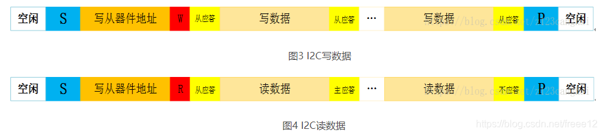
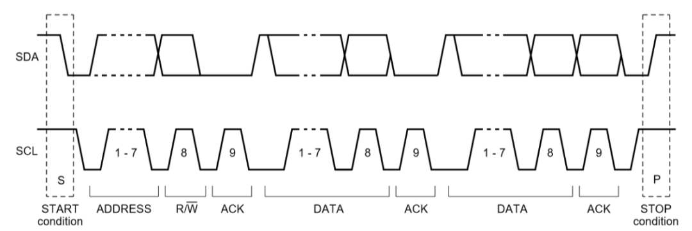

# IIC

I2C总线是由Philips（飞利浦）公司开发的一种简单、双向二线制同步串行总线。它只需要两根线即可在连接于总线上的器件之间传送信息。

‍

**启动信号：**

通信开始时，主设备发出启动信号。这通过将数据线（SDA）从高电平拉低，而时钟线（SCL）保持在高电平来实现。这个动作通知所有从设备主设备即将开始通信。

**发送设备地址及读写位：**

紧接着启动信号，主设备发送从设备的地址以及操作位（读/写）到数据线上。每个从设备都有一个唯一的地址。读写位决定了操作是读数据（通常设为1）还是写数据（通常设为0）。

**从设备应答：**

地址和读写位发送完毕后，被寻址的从设备需要通过发送一个应答信号（ACK）来响应。应答信号是在数据线（SDA）上产生一个低电平信号，同时时钟线（SCL）为高电平。

**数据传输：**

成功建立连接和从设备应答之后，数据可以开始传输。数据是按字节传输的，每传输完一个字节后，接收方（无论是主设备还是从设备）都需要发送一个应答信号（ACK）。

**停止信号：**

数据传输完成后，主设备发出一个停止信号来终止通信。这通过将数据线（SDA）从低电平拉高，而时钟线（SCL）保持在高电平来实现，标志着一次I2C交流的结束。
