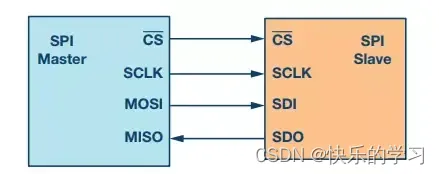
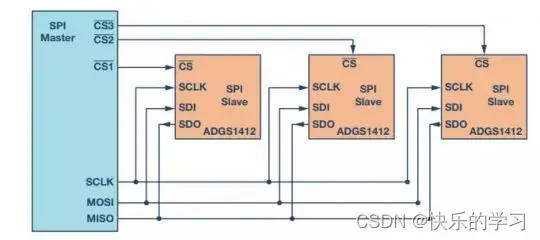
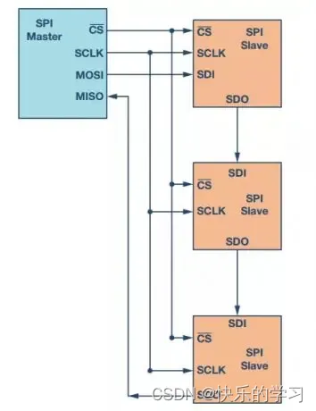
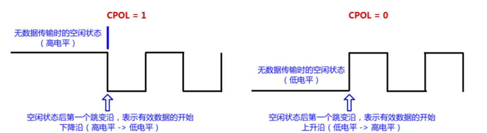
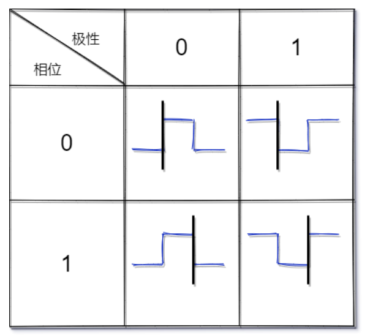
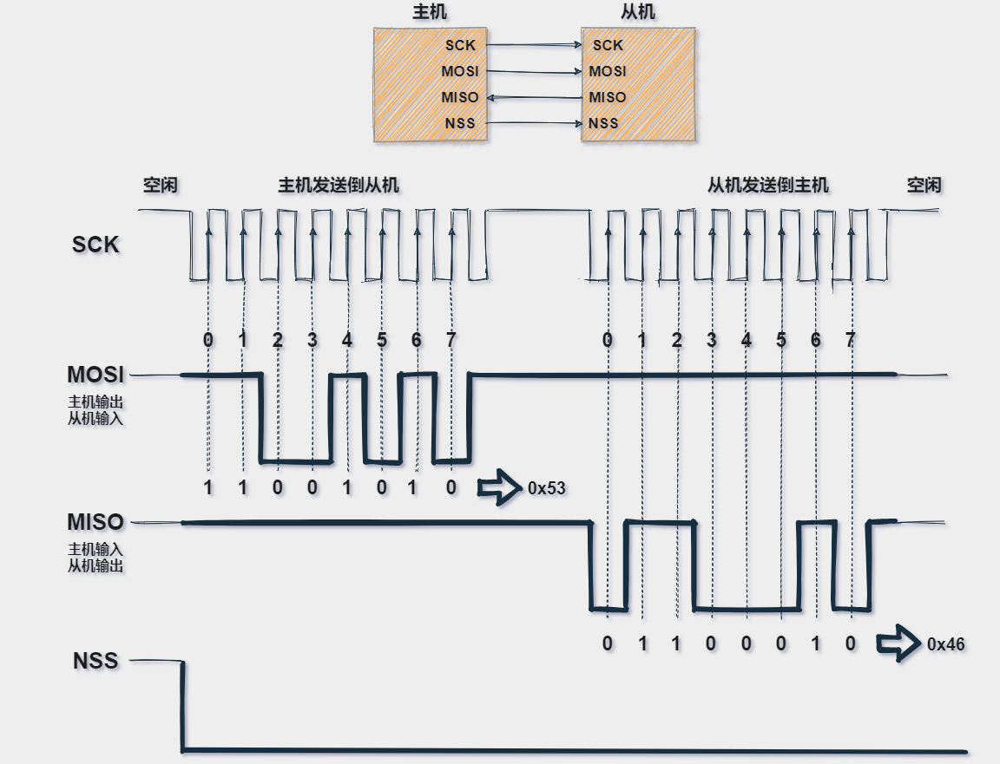

# SPI

SPI(Serial Peripheral Interface，串行外设接口) 协议是一种高速高效率、全双工的通信总线，允许CPu与低速的外围设备之间进行同步串行数据的传输，主要是用同步的时钟信号对串行的数据同时进行发送和接收操作，从而实现全双工。常用于短距离通讯，主要是在嵌入式系统中。

SPI总共包含4条逻辑线，分别如下。

- **MISO:**  （Master input slave output） 主机输入，从机输出(数据来自从机)
- **MOSI:**  （Master output slave input ）主机输出，从机输入(数据来自主机)
- **SCLK:**  （Serial clock）串行时钟信号，由主机产生发送给从机
- **SS:**  （Slave Select） 片选信号，由主机发送，以控制与哪个从机通信，通常是**低电平有效**信号

接口名称随制造商命名习惯而发生改变。如下是常见的其它命名。

- MISO也可以是SIMO，DOUT，DO，SDO 或 SO(在主机端)
- MOSI也可以是SOMI，DIN，DI，SDI或 SI (在主机端)
- NSS也可以是CE，CS或 SSEL
- SCLK也可以是SCK

### 拓扑结构

一个典型的SPI系统应包括只能有一个主机、一个或多个从机。

##### 单主从模式

##### 多主从模式

- 常规SPI模式

  在常规模式下，主机需要为每个从机提供**单独的片选信号**。一旦主机使能(拉低)片选信号，MOSI/MISO线上的时钟和数据便可用于所选的从机。如果使能多个片选信号，则MISO线上的数据会被破坏，因为主机无法识别哪个从机正在传输数据。

  

- 菊花链模式

  在菊花链模式下，**所有从机的片选信号连接在一起**，数据从一个从机传播到下一个从机。在此配置中，所有从机同时接收同一SPI时钟。来自主机的数据直接送到第一个从机，该从机将数据提供给下一个从机 。

  

### 通信过程

串行时钟SCK由SPI主机产生，每个时钟周期仅发送1bit数据。，SPI有四种操作模式，取决于时钟极性（CPOL）与时钟相位（CPHA）的组合。

CPOL：表示当SCK空闲的时候，其电平的值为0还是1

CPHA：表示数据采样是在第几个边沿，0对应第一个边沿，1对应于第二个边沿

- Mode0：CPOL=0，CPHA =0：当空闲态时，SCK 处于低电平，数据采样是在第 1 个边沿，也就是 SCK 由低电平到高电平的跳变，所以数据采样是在上升沿，数据发送是在下降沿。
- Mode1：CPOL=0，CPHA=1：当空闲态时，SCK 处于低电平，数据发送是在第 2 个边沿，也就是 SCK 由低电平到高电平的跳变，所以数据采样是在下降沿，数据发送是在上升沿。
- Mode2：CPOL=1，CPHA=0：当空闲态时，SCK 处于高电平，数据采集是在第 1 个边沿，也就是 SCK 由高电平到低电平的跳变，所以数据采集是在下降沿，数据发送是在上升沿。
- Mode3：CPOL=1，CPHA=1：当空闲态时，SCK 处于高电平，数据发送是在第 2 个边沿，也就是 SCK 由高电平到低电平的跳变，所以数据采集是在上升沿，数据发送是在下降沿。

|SPI mode|CPOL|CPHA|
| -------------| ------| ------|
|0（2‘b00）|0|0|
|1（2‘b01）|0|1|
|2（2‘b10）|1|0|
|3（2‘b11）|1|1|

下图示例中简单模拟 SPI 通信流程，主机拉低 NSS 片选信号，启动通信，并且产生时钟信号，上升沿触发边沿信号，主机在 MOSI 线路一位一位发送数据 0X53，在 MISO 线路一位一位接收数据 0X46

SPI 只有主模式和从模式之分，没有读和写的说法，外设的写操作和读操作是同步完成的。若只进行写操作，主机只需忽略接收到的字节（虚拟数据）；反之，若主机要读取从机的一个字节，就必须发送一个空字节来引发从机的传输。也就是说，你发一个数据必然会收到一个数据；你要收一个数据必须也要先发一个数据。

### 优缺点

#### SPI通讯的优势

使SPI作为串行通信接口脱颖而出的原因很多;

- 全双工串行通信;
- 高速数据传输速率。
- 简单的软件配置;
- 极其灵活的数据传输，不限于8位，它可以是任意大小的字;
- 非常简单的硬件结构。从站不需要唯一地址(与I2C不同)。从机使用主机时钟，不需要精密时钟振荡器/晶振(与UART不同)。不  
  需要收发器(与CAN不同)。

#### SPI的缺点

没有硬件从机应答信号(主机可能在不知情的情况下无处发送);

- 通常仅支持一个主设备;
- 需要更多的引脚(与I2C不同);
- 没有定义硬件级别的错误检查协议;
- 与RS-232和CAN总线相比，只能支持非常短的距离;
