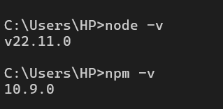
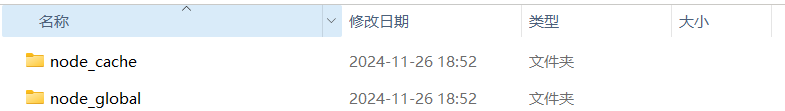
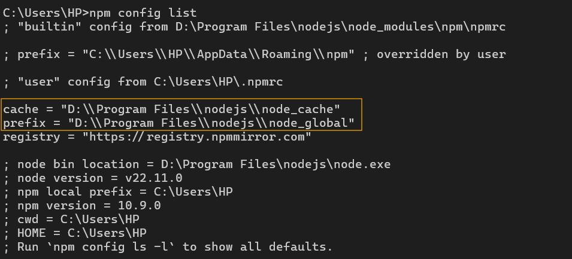

#### 安装node.js
从nodejs网站下载Windows安装程序，修改路径后正常点击next安装即可。

安装完毕后，查看刚才所安装的node版本、npm版本。如果有版本号则说明安装成功。

```bash
node –v
npm –v
```




#### 修改npm默认安装目录和缓存目录
npm默认将包和缓存暂存在C盘，久而久之会挤占大量空间，此处将路径修改到D盘。

创建两个子文件夹，分别命名为npm_global和npm_cache。这两个文件夹将分别用于存放全局安装的模块和缓存文件。


```bash
npm config set prefix "D:\Program Files\nodejs\node_global"
npm config set cache "D:\Program Files\nodejs\node_cache"
```

查看一下npm的安装路径、缓存路径

```bash
npm config get prefix
npm config get cache
```

设置环境变量

在【系统变量】中找到path变量，在末尾添加一个新条目，内容为

> D:\Program Files\nodejs\node_global\node_modules
>

在【用户变量】中找到path变量，将默认在c盘的npm包路径修改为

> D:\Program Files\nodejs\node_global
>

#### npm更换镜像源
```bash
npm config set registry http://registry.npmmirror.com/
```

用如下命令查看npm基本配置，可看到registry修改完成功。

```bash
npm config list
```




保存并退出环境变量设置，重启命令终端即可。

